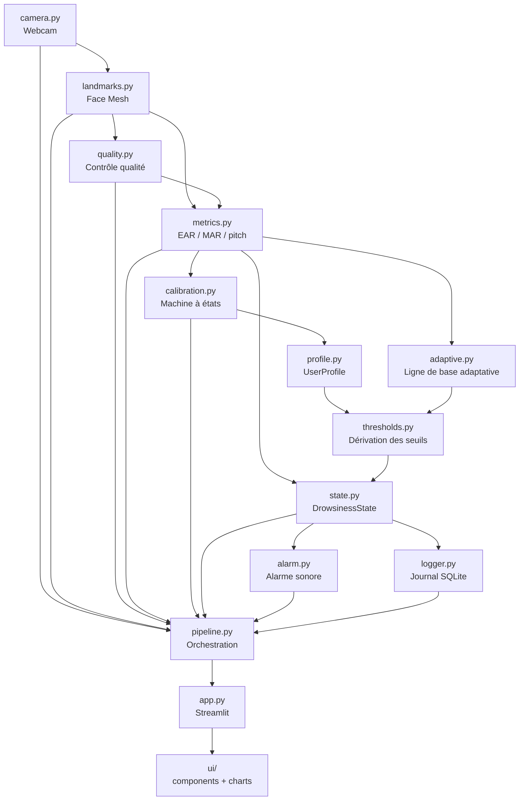

# Architecture DrowsiGuard

## Flux de données

## Couches et règles de dépendance

| Couche | Modules | Règle |
|---|---|---|
| **Calcul pur** | `metrics.py` | Aucune dépendance interne DrowsiGuard |
| **Données** | `profile.py`, `config.py` | Aucune logique de détection |
| **Analyse** | `quality.py`, `calibration.py`, `thresholds.py`, `adaptive.py`, `state.py` | Dépend de calcul pur + données uniquement |
| **Effets** | `alarm.py`, `logger.py` | Dépend de state uniquement |
| **Orchestration** | `pipeline.py` | Dépend de tout sauf `ui/` et `app.py` |
| **Présentation** | `ui/`, `app.py` | Aucune logique métier — affichage uniquement |

## Règles absolues

1. `metrics.py` ne dépend d'aucun autre module DrowsiGuard.
2. `ui/components.py` et `ui/charts.py` ne contiennent **aucune logique de détection**.
3. `app.py` ne contient **aucune logique métier** — uniquement des appels à `pipeline.py` et `ui/`.
4. Toute logique métier est dans `src/drowsiguard/` — jamais dans `app.py`.
5. Le temps (`timestamp`) est toujours injectable pour les tests.
